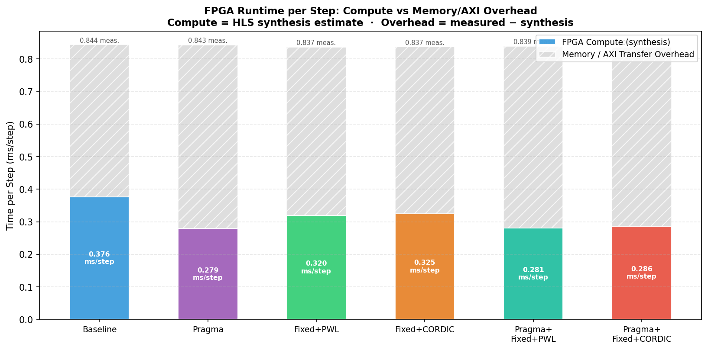
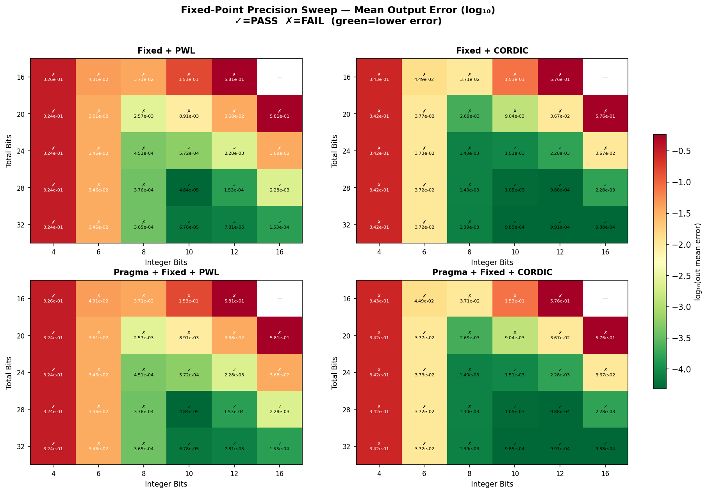
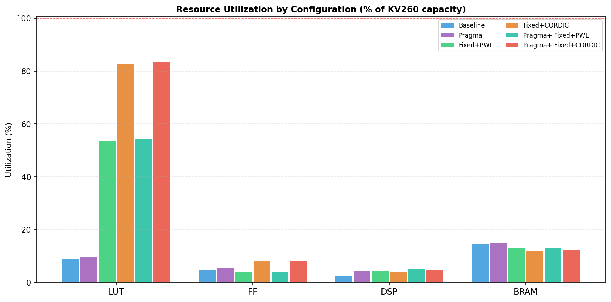

# Mamba-3 on an FPGA

**A custom hardware accelerator for the Mamba-3 autoregressive state update. It is ported from the official CuTe DSL GPU kernel to synthesizable C++/HLS and runs on an AMD Kria K26.**

<!-- 


 -->

State space models (SSMs) like Mamba are the leading alternative to Transformers for sequence modeling. During decoding, a Transformer attends over a KV cache that grows with the context, so each new token costs O(n) and a full sequence costs O(n²). An SSM instead folds its history into a fixed-size recurrent state, which makes each decode step **O(1) in time and memory**. The catch is that this state update has very low arithmetic intensity, so it is **memory-bound** on GPUs.

This project tests whether a dedicated datapath helps. I took the decode-step kernel from **Mamba-3** (Lahoti et al., 2026), translated it from CuTe DSL into Vitis HLS C++, explored six hardware variants, and benchmarked all of them on a Kria K26.

---

## Key findings

| | Result | Source |
|---|---|---|
| **Accuracy** | fp32 hardware matches the PyTorch reference to **4.6 × 10⁻⁵ max abs error** after 64 recurrent steps | Measured on board |
| **Compute optimization** | HLS pragmas cut kernel latency **24.1 → 17.9 ms per 64 steps (−25.8%)** at no accuracy cost | HLS synthesis estimate |
| **End-to-end runtime** | **~0.84 ms per step** for *all six* designs, regardless of compute optimizations | Measured on board |
| **Bottleneck** | **~55–67%** of per-step time is outside the kernel's compute (transfer, bridge, and driver overhead) | Inferred: measured − HLS estimate |
| **Headroom** | **~3×** if that overhead were eliminated entirely | Theoretical ceiling, not demonstrated |

The central result is a systems one. Compute optimizations that work in synthesis don't show up on the board, because the CPU↔FPGA interface dominates runtime. This matches the IO-aware view of SSM acceleration and points directly at the next engineering step (see [Roadmap](#roadmap)).

---

## Highlights

- **GPU kernel → FPGA hardware.** Translated the official Mamba-3 autoregressive kernel from NVIDIA CuTe DSL into synthesizable Vitis HLS C++. Extended it to run **64 recurrent steps per invocation**, keeping the state on-chip between steps.
- **Verified against the reference.** C simulation checks every step's output against the official PyTorch reference function. On the board, the final state and last-step output of each of 10 sequences match it within **4.6 × 10⁻⁵** (fp32).
- **25.8% lower compute latency.** HLS pragmas cut synthesized latency from **24.1 → 17.9 ms per 64 steps** with identical measured error. They pipeline the state-dimension loop, fully unroll the MIMO-rank loops, and partition the per-head arrays.
- **Two custom nonlinear-function engines.** `exp`, `sigmoid`, `tanh`, and SiLU are implemented in fixed point two ways: **piecewise-linear lookup tables** with range reduction, and a **24-iteration hyperbolic CORDIC** shift-add core.
- **116-configuration precision sweep** across total bits, integer bits, nonlinear engine, and pragma setting, mapping where fixed-point formats break down.
- **Diagnosed the system bottleneck** by comparing on-board runtime against the synthesis estimates (see [Where the time goes](#where-the-time-goes)).
- **Six bitstreams built, deployed, and benchmarked** on the K26.

---

## The Mamba-3 state update

At its core, every Mamba decode step is a first-order recurrence:

```
h_t = A ⊙ h_{t-1} + B ⊗ x_t        (decay old state, inject new input)
y_t = C · h_t                      (read out)
```

Mamba-3 makes this considerably richer than its predecessors:

- **Trapezoidal discretization** replaces Mamba-2's zero-order hold. It produces three per-step coefficients, α = exp(A·dt), β = (1 − trap)·dt·α, and γ = trap·dt, instead of one. This gives higher accuracy at the cost of more nonlinear math.
- **MIMO rank expansion (R)** adds a new dimension to B, C, and the projections to raise compute density.
- **Fused post-processing:** the kernel also performs the D-skip connection, SiLU gating against `z`, and the down-projection from rank R to the output.

The accelerator implements the full fused step in hardware. The evaluated configuration is 4 heads × head dimension 64 × state dimension 32 × MIMO rank 2, which gives an 8,192-value recurrent state.

---

## Architecture

**ARM host (Cortex-A53).** `src/kria/host.cpp` packs one invocation's inputs into a single buffer:
- constant tensors: A, D, and the x/z/out projections
- the initial state
- the per-step tensors (x, B, C, Bstate, Xstate, dt, trap, z) for all 64 steps

That totals about 108K fp32 words in. The host then writes them and reads the results back (about 25K words out) concurrently, using a writer thread and a reader on character devices. Concurrency is required because the output FIFO would otherwise fill and deadlock.

**CPU↔FPGA interface.** The processing system reaches the fabric through its `M_AXI_HPM0_FPD` master port and an AXI SmartConnect. These feed a **32-bit AXI4-Lite** slave, a bridge that converts register writes and reads into the kernel's `ap_fifo` input and output streams. Every word costs one AXI4-Lite transaction; there are no bursts and no DMA.

**FPGA datapath** (`src/hls/mamba3_step.cpp`, 100 MHz HLS target). Each invocation:
1. Reads the constant tensors and the initial state into on-chip buffers.
2. For each of the 64 steps:
   - reads that step's inputs;
   - computes α, β, and γ per head;
   - updates the state over (head × head-dim × state-dim), with the state-dimension loop pipelined and the MIMO-rank loops unrolled;
   - reads out with C;
   - applies the D-skip, SiLU gating, and down-projection;
   - streams out that step's 256-value output.
3. Streams out the final state after the last step.

**State and buffers.**
- The 8,192-entry state and next-state arrays live in dual-port BRAM.
- The per-step B, C, and Bstate tiles (256 words each) live in LUTRAM.
- The per-head scalars (A, dt, trap, D, α, β, γ) are fully partitioned so every head can be accessed in parallel.

**Nonlinear engines** (compile-time selectable, `src/hls/ssm_ops.h`):
- **fp32:** `hls::exp` and `hls::tanh`.
- **PWL:** `exp` uses range reduction (x = k·ln2 + r) with a 256-segment table over [0, ln2] on inputs clipped to [−14, 0]. `tanh` uses a 512-segment table. Sigmoid is computed as ½(1 + tanh(x/2)), and SiLU as x·σ(x).
- **CORDIC:** a 24-iteration hyperbolic CORDIC, including the repeated iterations at shifts 4 and 13 that it needs to converge.

---

## Results

### Design-space exploration

| Configuration | HLS latency (64 steps) | Measured time / step | LUT | FF | DSP | BRAM | Max error | Mean error |
|---|---:|---:|---:|---:|---:|---:|---:|---:|
| fp32 baseline | 24.1 ms | 0.844 ms | 8% | 4% | 2% | 14% | 4.6e-5 | 6.4e-7 |
| **fp32 + HLS pragmas** | **17.9 ms** | 0.843 ms | 9% | 5% | 4% | 14% | **4.6e-5** | **6.4e-7** |
| Fixed-point + PWL | 20.5 ms | 0.837 ms | 53% | 3% | 4% | 12% | 3.6e-2 | 7.3e-4 |
| Fixed-point + CORDIC | 20.8 ms | 0.837 ms | 82% | 8% | 3% | 11% | 1.2e-1 | 2.3e-3 |
| Pragmas + Fixed + PWL | 18.0 ms | 0.839 ms | 54% | 3% | 5% | 13% | 3.6e-2 | 7.3e-4 |
| Pragmas + Fixed + CORDIC | 18.3 ms | 0.837 ms | 83% | 8% | 4% | 12% | 1.2e-1 | 2.3e-3 |

<sub>
<b>HLS latency</b> comes from synthesis reports at a 100 MHz target (7.27 ns estimated critical path); it is an estimate, not a board measurement.<br/>
<b>Measured time / step</b> is the wall-clock time of the host's write+read call divided by 64, averaged over 10 invocations.<br/>
<b>Errors</b> are max/mean absolute error of the last-step output (256 values per sequence × 10 sequences), measured on board against the reference.<br/>
Fixed-point builds use <code>ap_fixed&lt;24,10&gt;</code>. Target device: <code>xck26-sfvc784-2LV-c</code>.
</sub>

**Takeaways:**
- **Pragmas give the best compute result.** fp32 with pragmas has the lowest estimated latency, identical accuracy to the baseline, and ~6–9× less LUT usage than the fixed-point variants.
- **Fixed-point doesn't pay off here.** On its own it trims estimated latency ~15% versus the fp32 baseline. But it costs 53–83% of the device's LUTs and roughly three orders of magnitude in error. Combined with pragmas, it is no faster than fp32 + pragmas.
- **PWL beats CORDIC.** CORDIC's shift-add iterations looked hardware-friendly on paper, but it used **>80% of LUTs**, about 2× the flip-flops of PWL, and had ~3× higher error. Adding iterations to close the accuracy gap would need resources the design no longer has.

### Where the time goes



Measured time per step is **0.837–0.844 ms for every configuration**, even though estimated compute varies from 0.279 to 0.376 ms per step. The bars split measured time into the HLS compute estimate and the remainder.

That remainder is **~55% of runtime for the baseline and ~67% for the pragma-optimized design**. It is **inferred, not directly measured**. It bundles AXI4-Lite transactions, bridge FIFOs, kernel-driver and syscall overhead, and any stalls where the kernel waits on input.

Several things point to the host interface as the bottleneck:
- Runtime is flat across designs.
- Each invocation moves ~133K 32-bit words (~530 KB) in ~54 ms, an effective **~10 MB/s**, or roughly 400 ns per word.
- That rate is consistent with single-beat AXI4-Lite accesses through a character-device driver, not with the kernel's compute rate.

Isolating each component (e.g. with an ILA or PL-side cycle counters) is listed under future work.

### Precision sweep



I swept 116 fixed-point configurations in C simulation: total bits {16, 20, 24, 28, 32} × integer bits {4, 6, 8, 10, 12, 16} × {PWL, CORDIC} × {pragmas off/on}. Each was checked against the reference on every step. 32 configurations passed.

A configuration **passes** if max absolute error stays below 0.5 for both the per-step outputs and the final state. That is a coarse sanity bound, so the heatmap reports mean error as well.

- **Fewer than 10 integer bits fails because of overflow, not precision.** At `ap_fixed<24,8>` (PWL), mean output error is 4.5 × 10⁻⁴, better than the passing `<24,10>`, but a single output is off by **29.6**. That points to an intermediate value overflowing its integer range.
- **No 16- or 20-bit format passes.** At `<20,10>`, mean error is ~9 × 10⁻³ and max error reaches 0.74.
- **24 bits is the practical floor.** `<24,10>` passes for both engines, so I used it for the hardware builds. `<28,10>` PWL brings mean output error down to 4.8 × 10⁻⁵.
- **The limit is worst-case outliers.** In passing formats, max error runs roughly 50–400× the mean. Future low-precision work should target range handling and approximation robustness before narrowing bit widths further.

### Resource utilization



---

## Limitations

- **No CPU or GPU performance baseline yet.** There is no direct ARM, x86, or GPU timing of the same kernel, so these results show where time goes on the FPGA vs the x86 c_sim.
- **The steps are not a closed autoregressive loop.** In each invocation, the 64 steps' inputs (x, B, C, dt, z, …) are supplied by the host from pre-generated test vectors. Only the recurrent state carries from step to step inside the kernel. In real decoding, step *t+1*'s inputs depend on the token sampled at step *t*, which would need the embedding, projections, and sampling on the FPGA or a host round-trip per token.
- **Synthetic data.** No pretrained Mamba-3 checkpoint was public during development, so inputs and weights are random tensors run through the official reference function.
- **On-board checks are end-of-sequence.** The board run compares the final state and last-step output of each sequence. Per-step comparison happens in C simulation.
- **Small model configuration** (4 heads, head dimension 64, state dimension 32, rank 2), sized for fast iteration rather than a production model.

---

## Engineering challenges

- **Floating-point drift.** Error initially blew up as rounding accumulated across chained products. I fixed it by normalizing the test inputs to keep intermediates in a safe dynamic range.
- **CuTe DSL → C++ translation.** The original kernel's tensor layouts and indexing conventions don't map one-to-one onto flat HLS arrays. Getting the index math right across heads, head dimension, state dimension, and MIMO rank was the main correctness hurdle.
- **Bitstream integration.** I integrated the HLS IP into a Vivado block design with the Zynq UltraScale+ processing system through an AXI4-Lite-to-stream bridge, and scripted the full HLS → Vivado flow in Tcl.
- **Automation.** Bash drivers run C simulation, synthesis, and on-board execution across all configurations, and a Matplotlib script generates the plots from the reports.

---

## Scaling considerations

The current design uses 14% of BRAM and no URAM. For reference, the K26 provides ~5.1 Mb of BRAM and 64 × 288 Kb of URAM, about 2.9 MB of on-chip memory in total.

A rough estimate puts one layer's state-update working set for a Mamba2-2.7B-sized configuration at ~1.6 MB. That would fit on-chip **for a single layer at a time**, with the full model's weights in the board's 4 GB of DDR4. This is a back-of-the-envelope estimate; the design hasn't been run at that scale. Making it work would also require replacing the AXI4-Lite interface, since data movement already dominates at the current small size.

---

## Roadmap

The theoretical ceiling from removing all non-compute overhead is **0.84 → 0.28 ms per step (~3×)**. Realistic gains depend on how much of the overhead the following can eliminate:

- [ ] **Replace the 32-bit AXI4-Lite link with AXI DMA** over the high-performance ports, with wide bursts.
- [ ] **Keep the recurrent state on-chip across invocations** so the 8,192-word state isn't re-sent and re-read every call.
- [ ] **Overlap transfer and compute** with HLS `DATAFLOW` and double-buffered streams.
- [ ] **Instrument the overhead** with PL-side cycle counters or an ILA to separate transfer, driver, and stall time.
- [ ] **CPU baseline:** run the same C++ kernel on the A53 cores (and x86) for a direct performance comparison.
- [ ] **Close the autoregressive loop on-chip** by moving the input projections on-chip, so that batched steps correspond to real token generation.
- [ ] **Evaluate with pretrained weights** once a Mamba-3 checkpoint is available.

---

## Tech stack

| Layer | Tools |
|---|---|
| Reference model | Python, PyTorch, official Mamba-3 implementation |
| Hardware design | C++ (Vitis HLS 2025.1), `ap_fixed` arithmetic, HLS pragmas, CORDIC & PWL function units |
| Implementation | Vivado 2025.1, Tcl automation |
| Platform | AMD Kria K26 SOM (Zynq UltraScale+ MPSoC) |
| Host runtime | C++ on ARM Cortex-A53, AXI4-Lite → HLS stream bridge |
| Analysis | Bash sweep automation, Matplotlib |

---

## Repository layout

```text
src/hls/              HLS accelerator: datapath, nonlinear engines, testbench
src/hls/data/         Golden test vectors (10 sequences × 64 steps)
src/hls/mamba_ssm/    Official Mamba-3 source (reference implementation)
src/kria/             ARM host runtime for on-board execution
artifacts/            Tcl scripts for HLS synthesis and Vivado bitstream builds
important_results/    Bitstreams, synthesis reports, on-board logs, plots
*_sweep.sh            Automated csim / synthesis / on-board sweep drivers
generate_golden.py    Golden-reference generator
prompt.py             Experimental text-generation harness (see below)
```

## Building it yourself

The golden vectors used for all results are checked in under `src/hls/data/` (the top-level `data` is a symlink to it). The commands below assume Linux with Vitis/Vivado 2025.1. If your install isn't under `/tools/Xilinx/2025.1`, override `XILINX_VITIS`, `XILINX_VITIS_HLS`, and `XILINX_VIVADO`.

```bash
make csim      MAMBA3_NSTEPS=64 MAMBA3_ENABLE_HLS_PRAGMAS=1   # C simulation vs. golden data
make dut       MAMBA3_NSTEPS=64 MAMBA3_ENABLE_HLS_PRAGMAS=1   # HLS synthesis → RTL
make bitstream MAMBA3_NSTEPS=64 MAMBA3_ENABLE_HLS_PRAGMAS=1   # Vivado bitstream
```

`MAMBA3_NSTEPS=64` must match the checked-in data and the on-board host build. To regenerate the vectors, run `generate_golden.py`. It imports the reference function from the vendored Mamba-3 source, which needs that package's dependencies (PyTorch, CUTLASS/CuTe DSL, `quack`, `cuda-python`):

```bash
PYTHONPATH=src/hls/mamba_ssm/ops/cute/mamba3 python3 generate_golden.py --nsteps=64 --samples=10
```

To run on the board, deploy, then run the sweep on the Kria:

```bash
./deploy_on_kria.sh <board-ip>      # sync bitstreams, data, and host code; build the host on-board
./bitstream_sweep.sh                # on the Kria: load each bitstream and run the host
```

### Experimental: text-generation harness

`prompt.py` wraps the kernel in a toy byte-level language model to exercise integration with a real token loop. In its current form:
- the CPU computes each token's state update and output, and those drive sampling;
- the FPGA then recomputes the same 64-step batch, and its final state is carried forward.

So the FPGA is not yet on the critical path for token generation; closing that loop is on the roadmap. Without trained weights (`weights.pt`), the output is noise.

---

## References

1. A. Lahoti et al., "Mamba-3: Improved Sequence Modeling using State Space Principles," [arXiv:2603.15569](https://arxiv.org/abs/2603.15569), 2026.
2. A. Gu and T. Dao, "Mamba: Linear-Time Sequence Modeling with Selective State Spaces," [arXiv:2312.00752](https://arxiv.org/abs/2312.00752), 2023.
3. T. Dao and A. Gu, "Transformers are SSMs: Generalized Models and Efficient Algorithms Through Structured State Space Duality," [arXiv:2405.21060](https://arxiv.org/abs/2405.21060), 2024.
4. T. Dao et al., "FlashAttention: Fast and Memory-Efficient Exact Attention with IO-Awareness," [arXiv:2205.14135](https://arxiv.org/abs/2205.14135), 2022.
